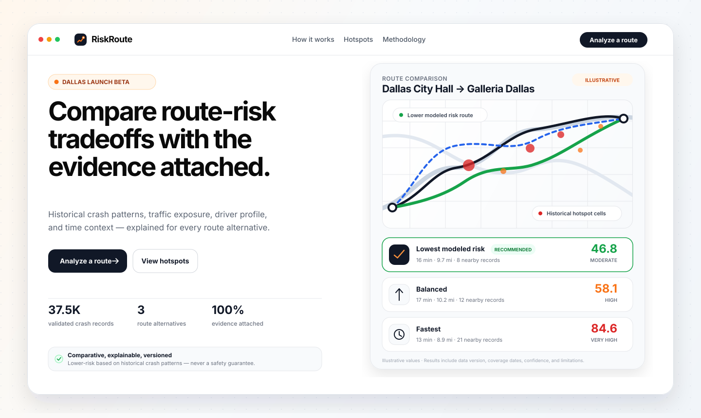
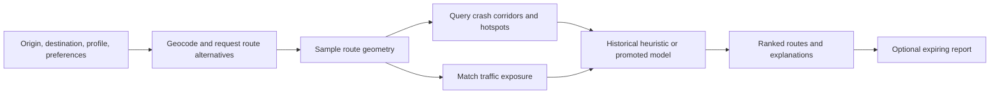
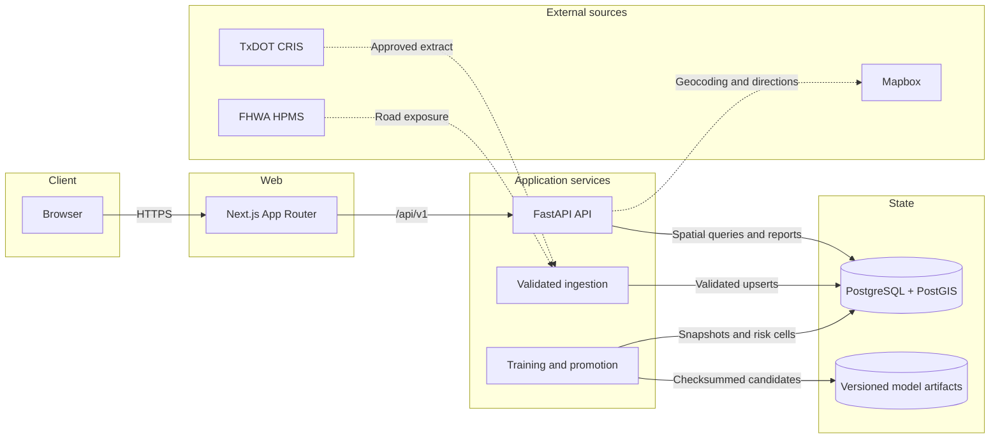

<h1 align="center">RiskRoute</h1>

<p align="center"><strong>Explainable route-risk intelligence for Dallas.</strong></p>

<p align="center">Compare driving alternatives using historical crash patterns and traffic exposure, with each score's source, coverage, confidence, and limitations attached.</p>

<p align="center">
  <a href="https://github.com/Krrish-Verma/RiskRoute/actions/workflows/ci.yml"></a>
  <a href="./frontend/package.json"></a>
  <a href="./backend/requirements.txt"></a>
  <a href="./docker-compose.yml"></a>
  <a href="./.python-version"></a>
  <a href="./.nvmrc"></a>
</p>

<p align="center">
  <a href="#preview"><strong>Preview</strong></a> ·
  <a href="#product-tour"><strong>Product tour</strong></a> ·
  <a href="#quick-start"><strong>Quick start</strong></a> ·
  <a href="#architecture"><strong>Architecture</strong></a> ·
  <a href="#api-reference"><strong>API</strong></a> ·
  <a href="#risk-and-ml-methodology"><strong>Methodology</strong></a>
</p>

> [!IMPORTANT]
> RiskRoute is a Dallas validation-stage product. The current crash snapshot is bootstrap-only and no calibrated model is active. Results describe comparative historical evidence; they do not guarantee that a route is safe.

## Preview

<a href="./docs/assets/riskroute-preview.svg">
  
</a>

<p align="center"><sub>Illustrated from the real product interface. Values shown above are explicitly illustrative, not live route guidance.</sub></p>

## Why RiskRoute

Navigation products usually optimize for time and distance. RiskRoute adds a careful third lens: comparative historical crash exposure.

| Compare | Understand | Decide |
| --- | --- | --- |
| Review fastest, balanced, and lower-modeled-risk alternatives together. | See crash density, severity, hotspots, traffic exposure, driver/time context, and uncertainty. | Choose deliberately with the tradeoff and evidence visible, without claiming certainty. |

RiskRoute is not a generic chatbot. It is a geospatial analysis system that keeps routing, spatial evidence, model state, and data provenance traceable from request to saved report.

## Product tour

<details open>
<summary><strong>Analyze route alternatives</strong></summary>
<br>

Enter an origin and destination, choose a driver profile and departure time, and set preferences such as avoiding highways, avoiding night-risk weighting, or preferring lower modeled risk. The analysis view presents selectable route cards beside a shared map, with ETA, distance, nearby crash records, severe crashes, hotspot segments, exposure coverage, confidence, and score basis.

Route: [`/analyze`](./frontend/app/analyze/page.tsx)

</details>

<details>
<summary><strong>Explore historical hotspot cells</strong></summary>
<br>

Search the Dallas launch area and inspect relative hotspot cells on an interactive Leaflet/OpenStreetMap view. Each response includes dataset provenance and a reminder that missing records are not evidence of low risk.

Route: [`/hotspots`](./frontend/app/hotspots/page.tsx)

</details>

<details>
<summary><strong>Save, share, print, and export reports</strong></summary>
<br>

Save the selected alternative with a retry-safe idempotency key. Reports have public read links, support browser print/PDF and JSON export, and use an anonymous owner secret for listing and deletion. Reports expire according to the configured retention period.

Routes: [`/reports`](./frontend/app/reports/page.tsx) and [`/report/[id]`](./frontend/app/report/%5Bid%5D/page.tsx)

</details>

<details>
<summary><strong>Inspect methodology and data context</strong></summary>
<br>

The product exposes score semantics, data dates, dataset and model versions, confidence context, geographic bounds, and known limitations. Demo heuristics are visibly labeled uncalibrated; production will not silently fall back to mock routing or an unpromoted model.

Route: [`/methodology`](./frontend/app/methodology/page.tsx)

</details>

### Pages at a glance

| Page | Purpose |
| --- | --- |
| `/` | Editorial product overview and illustrative route comparison |
| `/analyze` | Route input, preferences, map, evidence cards, and report creation |
| `/hotspots` | Dallas hotspot map and ranked list with provenance |
| `/reports` | Reports owned by the current anonymous browser session |
| `/report/[id]` | Shareable report, print/PDF, JSON export, and owner-only deletion |
| `/methodology` | Score meaning, evidence, uncertainty, and limitations |
| `/feedback` | Privacy-conscious product feedback |
| `/privacy`, `/terms` | MVP policy pages |

## How an analysis works



1. The API validates both locations against the configured Dallas/North Dallas boundary.
2. Mapbox supplies geocoding and route alternatives; demo mode can use a clearly labeled mock route when enabled.
3. RiskRoute samples each route geometry and queries nearby historical crash evidence.
4. FHWA road exposure is matched where available so raw crash counts are not treated as equal across unlike roads.
5. The active calibrated model scores the route when one is promoted; otherwise a visibly uncalibrated historical heuristic is used only in demo/test mode.
6. Alternatives are ranked and returned with plain-language explanations, data/model versions, coverage, confidence, and limitations.

## Core capabilities

- Dallas/North Dallas launch boundary with fail-closed geographic validation.
- Fastest, balanced, and lower-modeled-risk route comparison.
- Driver profiles for new, normal, cautious, and parent contexts.
- Departure-time, highway, and night-risk preference signals.
- Historical crash density, severity, corridor, and hotspot evidence.
- FHWA HPMS traffic-exposure matching and explicit coverage reporting.
- Leaflet/OpenStreetMap visualization with selectable alternatives and crash markers.
- Versioned dataset/model context attached to analyses, hotspots, and reports.
- Anonymous, expiring, idempotently saved reports with print/PDF and JSON export.
- Structured API errors with correlation IDs, request limits, and provider circuit breaking.
- Production gates for PostGIS, Mapbox, authoritative crash data, calibrated models, and exact HTTPS CORS origins.

## Quick start

### Docker Compose

Requirements: Docker with Compose.

```powershell
Copy-Item .env.example .env
docker compose up --build --detach
docker compose ps
```

Open the local services:

| Service | URL |
| --- | --- |
| Web app | <http://localhost:3000> |
| API | <http://localhost:8000> |
| OpenAPI docs | <http://localhost:8000/docs> |
| Liveness | <http://localhost:8000/health> |
| Readiness | <http://localhost:8000/ready> |

The Compose defaults run in clearly labeled demo mode with PostGIS, migrations, API, and frontend services. Stop without deleting data:

```powershell
docker compose down
```

Do not add `--volumes` unless discarding the local database is intentional.

<details>
<summary><strong>Native development on Windows</strong></summary>
<br>

Pinned runtimes are Python 3.12.13, Node 22.23.1, and npm 10.8.3.

```powershell
python -m venv .venv
.\.venv\Scripts\python.exe -m pip install -r backend\requirements.txt
```

For native development, create `backend/.env` with at least:

```dotenv
APP_MODE=demo
ENVIRONMENT=development
DATABASE_URL=sqlite:///./riskroute.db
ALLOW_MOCK_MAPBOX=true
SEED_DEMO_DATA=true
CORS_ORIGINS=http://localhost:3000,http://127.0.0.1:3000
```

Then start the API:

```powershell
Push-Location backend
..\.venv\Scripts\alembic.exe upgrade head
..\.venv\Scripts\python.exe -m app.scripts.seed_demo_data
..\.venv\Scripts\python.exe -m uvicorn app.main:app --reload
Pop-Location
```

In a second terminal:

```powershell
Push-Location frontend
npm ci
$env:NEXT_PUBLIC_API_BASE_URL="http://127.0.0.1:8000"
npm run dev
Pop-Location
```

After dependencies and environment values are ready, [`start-app.ps1`](./start-app.ps1) is a convenience launcher for both processes.

</details>

<details>
<summary><strong>Native development on macOS/Linux</strong></summary>
<br>

```bash
python3 -m venv .venv
source .venv/bin/activate
python -m pip install -r backend/requirements.txt

cd backend
alembic upgrade head
python -m app.scripts.seed_demo_data
python -m uvicorn app.main:app --reload
```

Use the same `backend/.env` values shown in the Windows section. In another terminal:

```bash
cd frontend
npm ci
NEXT_PUBLIC_API_BASE_URL=http://127.0.0.1:8000 npm run dev
```

</details>

## Configuration

Start from [`.env.example`](./.env.example). Docker Compose reads the root `.env`; native FastAPI development reads `backend/.env` or shell environment variables.

| Variable | Purpose | Local default |
| --- | --- | --- |
| `APP_MODE` | `demo`, `test`, or fail-closed `production` behavior | `demo` |
| `DATABASE_URL` | SQLAlchemy connection string | Compose PostGIS URL; native code defaults to SQLite |
| `MAPBOX_ACCESS_TOKEN` | Server-side geocoding and directions token | empty |
| `ALLOW_MOCK_MAPBOX` | Permit labeled mock routing outside production | `true` |
| `SEED_DEMO_DATA` | Seed explicitly marked demo crash records | `true` |
| `CORS_ORIGINS` | Exact comma-separated browser origins | local ports 3000 |
| `DATASET_MAX_AGE_DAYS` | Maximum accepted dataset age | `550` |
| `REPORT_RETENTION_DAYS` | Saved-report retention window | `30` |
| `FEEDBACK_RETENTION_DAYS` | Feedback retention window | `365` |
| `TELEMETRY_RETENTION_DAYS` | Product-event retention window | `90` |
| `NEXT_PUBLIC_API_BASE_URL` | Browser-visible API origin | `http://localhost:8000` |
| `NEXT_PUBLIC_MAPBOX_TOKEN` | Optional browser-visible map token | empty |

> [!CAUTION]
> Never expose the server-side `MAPBOX_ACCESS_TOKEN`, database credentials, report owner secrets, or private CRIS data through a `NEXT_PUBLIC_*` variable or Git commit.

## Architecture



The Next.js frontend never fabricates successful API results. FastAPI owns validation, data readiness, route analysis, report ownership, and structured errors. PostgreSQL/PostGIS provides geometry columns and GIST-indexed corridor queries in Compose/production; SQLite is a bounded native/test fallback. Alembic is the production schema mechanism.

### Technology stack

| Layer | Technology |
| --- | --- |
| Frontend | Next.js 16.3, React 19.2, TypeScript, Tailwind CSS 3.4 |
| Maps and UI | Leaflet, React Leaflet, OpenStreetMap tiles, Lucide icons |
| API | FastAPI, Pydantic 2, SQLAlchemy 2, Alembic |
| Spatial data | PostgreSQL 16 + PostGIS 3.4; SQLite for bounded local/test use |
| Data and ML | pandas, scikit-learn, joblib |
| Quality | pytest, Vitest, Testing Library, axe-core, dependency audits |
| Delivery | Docker Compose, multi-stage images, GitHub Actions |

### Repository layout

```text
RiskRoute/
|-- frontend/                 Next.js application, components, and tests
|-- backend/
|   |-- app/routes/           Versioned API endpoints
|   |-- app/services/         Routing, scoring, reporting, and data services
|   |-- app/ingestion/        Dallas and generic ArcGIS ingestion
|   |-- app/ml/               Feature contract and model lifecycle
|   |-- app/scripts/          Sync, seed, train, purge, and load tools
|   |-- app/tests/            Backend regression suite
|   `-- alembic/              Production database migrations
|-- docs/assets/              README and documentation visuals
|-- .github/workflows/        CI and scheduled data synchronization
|-- docker-compose.yml        Local PostGIS/API/frontend stack
|-- OPERATIONS.md             Release and production runbook
`-- .env.example              Documented environment contract
```

## Release and data status

Production readiness intentionally fails closed until authoritative data and a calibrated model meet every gate.

| Area | Current state |
| --- | --- |
| Product stage | Validation/demo; not a public production launch |
| Geographic boundary | Dallas/North Dallas: latitude `32.60` to `33.15`, longitude `-97.05` to `-96.40` |
| Crash snapshot | Audited local snapshot: 37,541 validated Dallas 2019 records; real but bootstrap-only because reuse rights are unstated and coverage is one year |
| Current exposure | Audited local snapshot: 23,596 FHWA HPMS 2024 road segments; CC0 1.0 |
| Historical exposure | Audited local snapshot: 15,176 FHWA HPMS 2018 road segments; U.S. Government Work/public domain |
| Model | No active promoted model; the one-year crash snapshot cannot form the required history and held-out target windows |
| Demo behavior | May use 210 explicitly marked seed crashes and labeled, uncalibrated heuristics |
| Production behavior | Requires PostGIS, Mapbox, authoritative fresh crash metadata, an active calibrated model, no seed/mock mode, and exact HTTPS CORS |

Generated databases, import reports, raw/restricted data, and model artifacts are intentionally ignored by Git and are not bundled with a fresh clone.

<details>
<summary><strong>Data provenance and ingestion</strong></summary>
<br>

RiskRoute records dataset version, checksum, coverage dates, bounding box, row/rejection counts, source URL, license status, and last successful synchronization. Analyses and hotspot responses carry that context plus the active model version and limitations.

- **Production crash source:** an operator-authorized [TxDOT CRIS Public Extract](https://www.txdot.gov/data-maps/crash-reports-records/crash-data-analysis-statistics.html). Authentication, MFA, CAPTCHA, access approval, and reuse approval remain human/legal boundaries.
- **Bootstrap crash source:** the public [Dallas 2019 ArcGIS layer](https://services2.arcgis.com/rwnOSbfKSwyTBcwN/ArcGIS/rest/services/DallasCrashData/FeatureServer/0). Because the layer states no reuse license, it is restricted to isolated nonproduction evaluation.
- **Traffic exposure:** [FHWA HPMS 2024](https://catalog.data.gov/dataset/highway-performance-monitoring-system-hpms-2024) and the [historic HPMS catalog](https://catalog.data.gov/dataset/historic-highway-performance-monitoring-hpms-data). Features are bounded, normalized, deduplicated, and stored with vintage-specific provenance.

Public FHWA refreshes:

```powershell
Push-Location backend
..\.venv\Scripts\python.exe -m app.scripts.sync_dallas_data --source exposure
..\.venv\Scripts\python.exe -m app.scripts.sync_dallas_data --source historical-exposure
Pop-Location
```

The `crashes` sync option loads only the one-year bootstrap layer and is blocked in production. For production, an authorized operator places an approved CRIS CSV on a private runner:

```powershell
Push-Location backend
..\.venv\Scripts\python.exe -m app.scripts.ingest_cris_extract `
  --input D:\secure-input\dallas-cris.csv `
  --usage-approved --full-refresh --promote
Pop-Location
```

Promotion requires production mode, PostGIS, reviewed usage approval, an acceptable rejection rate, at least five years of coverage, and a policy-compliant latest crash date. Person- and vehicle-unit tables are excluded; the importer keeps only the crash-level allowlist needed for risk analysis.

</details>

## Risk and ML methodology

Without an active model, demo results are labeled `exposure_adjusted_history` or `demo`. They report nearby crash patterns, severity, hotspot concentration, profile/time context, AADT coverage, estimated million vehicle-miles, normalized rates, confidence context, bounds, and score meaning. Lower scores mean lower modeled historical exposure among the alternatives, not certainty about future conditions.

The versioned lifecycle predicts whether an exposure-covered `0.01°` road cell has at least one reported crash in a held-out target year. It includes:

- non-overlapping history and target windows with point-in-time AADT;
- spatial-block fit, calibration, and untouched test partitions;
- exposure-only and historical-rate baselines;
- Platt calibration, ROC AUC, PR AUC, Brier score, ten-bin ECE, reliability bins, and geographic subgroup audit;
- explicit sample, class, exposure, calibration, and baseline promotion gates;
- immutable candidate artifacts, SHA-256 verification, registry state, and versioned risk cells.

No demographic fields are available or used. The evaluation records that demographic bias cannot be assessed and substitutes a geographic audit. Read the [full ML methodology](./backend/app/ml/METHODOLOGY.md).

<details>
<summary><strong>Train and promote a model</strong></summary>
<br>

Evaluate without writing model state:

```powershell
Push-Location backend
..\.venv\Scripts\python.exe -m app.scripts.train_risk_model --dry-run
Pop-Location
```

After an authoritative multi-year crash snapshot and point-in-time exposure pass all gates, omit `--dry-run` to create a candidate. Promotion is a separate production-only action:

```powershell
Push-Location backend
..\.venv\Scripts\python.exe -m app.scripts.train_risk_model --promote
Pop-Location
```

A candidate never silently replaces the active model. Promotion archives the previous registry entry, checksum-verifies artifacts and evaluation output, and materializes risk cells only after every gate passes.

</details>

## API reference

Product endpoints are versioned under `/api/v1`; operational endpoints remain unversioned.

| Method | Endpoint | Purpose |
| --- | --- | --- |
| `GET` | `/health` | Process liveness |
| `GET` | `/ready` | Dependencies, data, and model readiness |
| `GET` | `/api/v1/data-status` | Current provenance and readiness context |
| `POST` | `/api/v1/analyze-route` | Compare route alternatives |
| `GET` | `/api/v1/locations/search` | Dallas-bounded location autocomplete |
| `GET` | `/api/v1/hotspots` | Historical hotspot cells |
| `POST`, `GET` | `/api/v1/reports` | Create or list owned reports |
| `GET`, `DELETE` | `/api/v1/reports/{id}` | Read or owner-delete one report |
| `POST` | `/api/v1/feedback` | Submit privacy-conscious feedback |
| `POST` | `/api/v1/telemetry/events` | Record bounded product events |

<details>
<summary><strong>Request and response examples</strong></summary>
<br>

```bash
curl -sS http://localhost:8000/api/v1/data-status

curl -sS -X POST http://localhost:8000/api/v1/analyze-route \
  -H "Content-Type: application/json" \
  -H "X-Request-ID: example-001" \
  -d '{
    "origin":"32.7767,-96.7970",
    "destination":"32.9537,-96.8398",
    "driver_profile":"normal_driver",
    "preferences":{
      "avoid_highways":false,
      "avoid_night_risk":false,
      "prefer_safest":true
    }
  }'

curl -sS "http://localhost:8000/api/v1/locations/search?q=Mockingbird%20Lane"
curl -sS "http://localhost:8000/api/v1/hotspots?limit=25&offset=0"
```

Errors share one envelope and echo the correlation ID:

```json
{
  "error": {
    "code": "upstream_unavailable",
    "message": "The routing provider is temporarily unavailable.",
    "details": {},
    "request_id": "example-001"
  }
}
```

Report creation accepts a retry-stable `Idempotency-Key` and an anonymous owner secret in `X-Anonymous-Session`. Public report IDs are shareable read links; listing and deletion require the owner secret. Never log that value or place it in a URL.

</details>

Interactive OpenAPI documentation is available at `/docs` outside production.

## Quality checks

```powershell
Push-Location backend
..\.venv\Scripts\python.exe -m pytest app\tests -q
..\.venv\Scripts\python.exe -m pip install pip-audit==2.10.1
..\.venv\Scripts\python.exe -m pip_audit -r requirements.txt --strict
Pop-Location

Push-Location frontend
npm test
npm run typecheck
npm run build
npm audit --audit-level=high
Pop-Location
```

The backend suite covers API/database isolation, report ownership and expiry, Mapbox failures, source normalization, migrations, spatial scoring, and ML leakage/promotion gates. Frontend tests cover fail-closed API behavior, provenance, route selection, confidence/exposure display, and automated accessibility checks.

CI also runs a fresh PostGIS migration/schema assertion and builds both container images. A bounded load smoke is available while the API is running:

```powershell
Push-Location backend
..\.venv\Scripts\python.exe -m app.scripts.load_test --requests 20 --concurrency 5 --p95-threshold-ms 5000
Pop-Location
```

## Operations

Read [`OPERATIONS.md`](./OPERATIONS.md) for migrations, releases, private CRIS import, schedules, retention, monitoring, backups, restore drills, rollback, secrets, and readiness gates.

- Run `alembic upgrade head` as one controlled release job.
- Deploy immutable image digests to staging before production.
- Require managed TLS PostGIS and an exact HTTPS CORS allowlist.
- Refresh exposure weekly and purge expired reports daily.
- Alert on 5xx/latency, provider quota/circuit state, database saturation, dataset age, ingestion rejection, and model/data drift.
- Preserve point-in-time recovery and rehearse restore quarterly.

The checked-in Compose stack is local/single-host infrastructure, not a substitute for managed services, secret storage, external uptime monitoring, or an incident-response platform.

<details>
<summary><strong>Troubleshooting</strong></summary>
<br>

- **`/ready` returns 503:** inspect its dependency/data details, run migrations, and confirm the active crash snapshot. Do not bypass freshness or license gates.
- **Analysis returns a provider error:** retain the request ID, verify the server-side Mapbox token/quota, and wait for the circuit reset. Production never returns a mock route.
- **Autocomplete returns no locations:** use at least three characters and a location within the configured Dallas boundary.
- **The frontend cannot reach the API:** verify `NEXT_PUBLIC_API_BASE_URL`, the exact CORS origin, and proxy support for `X-Anonymous-Session`.
- **Training refuses to run:** read the reported sample/window/exposure gate; the one-year bootstrap snapshot is intentionally insufficient.
- **A Next build reports `EPERM` on Windows:** stop workspace-owned Node processes, remove the ignored `.next` directory, and retry from a clean `npm ci`.

</details>

## Contributing

1. Branch from the intended release commit and keep raw/restricted data out of Git.
2. Add an Alembic revision for every schema change; do not use `create_all()` as a production migration.
3. Update backend schemas and `frontend/lib/types.ts` together when an API contract changes.
4. Add regression tests and run the complete quality checks.
5. Review source/license, privacy, geography, freshness, and model gates before changing dataset/model status.
6. Open a pull request with a rollback note for operational changes; CI should be green before merge.

## Security

Do not open a public issue containing a vulnerability, owner secret, database URL, Mapbox token, raw CRIS row, or personal information. Report it privately to the repository owner/security contact, include the affected version and redacted reproduction steps, and allow coordinated remediation. Rotate an exposed secret immediately and follow the incident procedure in [`OPERATIONS.md`](./OPERATIONS.md).

## Responsible-use limitations

RiskRoute describes patterns in historical, reported crashes and available traffic exposure. Reporting practices, road changes, live incidents, weather, construction, unmapped local-road exposure, and other conditions can make current risk differ.

- A lower score is comparative, not a declaration that a route is safe.
- Missing records are not proof of low risk.
- The product does not predict or guarantee real-time safety.
- It does not replace official navigation, traffic guidance, emergency advice, or driver judgment.
- It does not establish that a route causes or prevents crashes.

## Usage and licensing

No open-source license file is currently included. Unless the repository owner adds one, standard copyright restrictions apply.

---

<div align="center">
  <strong>Lower-risk based on historical crash patterns — with the evidence attached.</strong>
</div>
